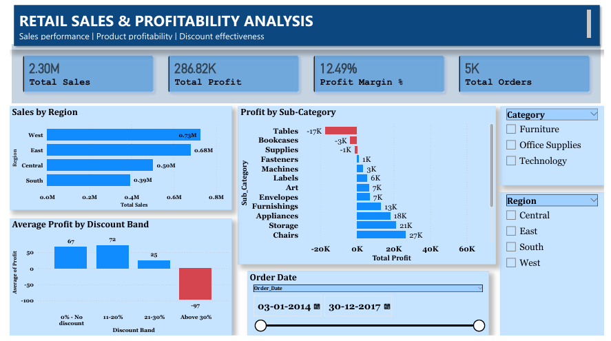

# Retail Sales & Profitability Analysis

An end-to-end business analytics project using **SQL Server, Power BI, and DAX** to analyze retail sales, profitability, regional performance, product sub-categories, and discount effectiveness.



## Business Problem

Retail businesses need to understand which regions drive revenue, which products generate or lose profit, and how discounting relates to profitability. This project uses transactional retail data to identify performance gaps and develop data-driven recommendations.

## Project Objectives

- Measure sales, profit, profit margin, order volume, and customer count.
- Compare regional sales and profitability.
- Identify profitable and loss-making product sub-categories.
- Analyze profit patterns across discount bands.
- Build an interactive Power BI dashboard with region, category, and date filters.
- Translate findings into actionable business recommendations.

## Tools & Technologies

- **SQL Server Express:** Data storage and analytical queries.
- **SQL Server Management Studio (SSMS):** Database management and SQL development.
- **Microsoft Power BI Desktop:** Interactive dashboards and data visualization.
- **DAX:** KPI measures and calculated columns.

## Repository Structure

```text
retail-sales-profitability-analysis/
├── README.md
├── dashboard/
│   └── Retail_Sales_Profitability_Analysis.pbix
├── sql/
│   ├── 01_database_setup.sql
│   ├── 02_kpi_analysis.sql
│   ├── 03_regional_analysis.sql
│   ├── 04_product_profitability.sql
│   └── 05_discount_analysis.sql
├── screenshots/
│   └── dashboard_overview.png
└── docs/
    └── business_recommendations.md
```

## Key Performance Indicators

| KPI | Definition |
|---|---|
| Total Sales | Sum of transaction sales |
| Total Profit | Sum of available profit values |
| Profit Margin | Total profit divided by total sales |
| Total Orders | Distinct count of order IDs |
| Total Customers | Distinct count of customer IDs |
| Units Sold | Sum of quantity |
| Average Discount | Average transaction-line discount |

## Key Findings

The following findings are based on the initial SQL analysis and should be revalidated against the final dashboard measures before publication.

### 1. Regional Performance

- The West region recorded the highest sales and total profit.
- Central had the lowest regional profit margin, at approximately **7.92%**.

### 2. Product Profitability

- Tables generated approximately **$17,305 in losses**, with a profit margin of **-8.36%**.
- Bookcases generated approximately **$3,473 in losses**, with a profit margin of **-3.02%**.
- Copiers recorded a profit margin of approximately **37.20%** in the sub-category analysis.

### 3. Discount Effectiveness

- Transactions with discounts above 30% had an aggregate profit margin of approximately **-37.28%**.
- The no-discount band had a profit margin of approximately **29.51%**.

These are descriptive relationships and do not establish that discounts alone caused the observed losses.

## Dashboard Features

- KPI cards for sales, profit, profit margin, and order volume.
- Regional sales comparison.
- Product sub-category profitability analysis.
- Average profit per order line by discount band.
- Interactive Region, Category, and Order Date slicers.

## Business Recommendations

1. Review the pricing and cost structure of loss-making product sub-categories, particularly Tables and Bookcases.
2. Investigate transactions with discounts above 30% and test revised discount approval thresholds.
3. Examine product mix, costs, and sales patterns in the Central region.
4. Monitor sales and profit margin together rather than maximizing revenue alone.
5. Validate proposed changes through further analysis before introducing business-wide pricing policies.

See [`docs/business_recommendations.md`](docs/business_recommendations.md) for the detailed recommendations and limitations.

## How to Reproduce the Analysis

### Prerequisites

- SQL Server Express.
- SQL Server Management Studio.
- Power BI Desktop.
- The source Superstore CSV dataset.

### Setup

1. Obtain the dataset from its original publisher and review the applicable license and usage conditions.
2. Open `sql/01_database_setup.sql` in SSMS and execute it.
3. Import the CSV into the `RetailAnalytics` database as `dbo.Superstore`.
4. Run the remaining SQL scripts in numerical order.
5. Open the Power BI report in the `dashboard/` folder.
6. If necessary, update the SQL Server connection to your local instance and refresh the report.

**Data quality note:** The initial import contained 9,994 rows and one missing Profit value. The discount analysis excludes rows with missing Profit. Other analyses should document their null-handling rules consistently.

## Dataset & Attribution

The project uses the Sample Superstore retail dataset, commonly distributed through public educational dataset repositories.

**Source:** [Kaggle — Superstore Dataset](https://www.kaggle.com/datasets/vivek468/superstore-dataset-final)

Before redistributing the dataset or publishing it in this repository, verify the source's license and attribution requirements. The dataset itself is not included in this repository.

## Limitations

- The analysis is descriptive and does not establish causal relationships.
- The sample dataset may not represent current retail conditions.
- Missing values and data types can affect calculations if not handled consistently.
- Discount-related findings should be investigated further while accounting for product mix, region, and costs.

## Author

Developed as a portfolio project demonstrating SQL querying, KPI development, data analysis, Power BI visualization, and business recommendation skills.

